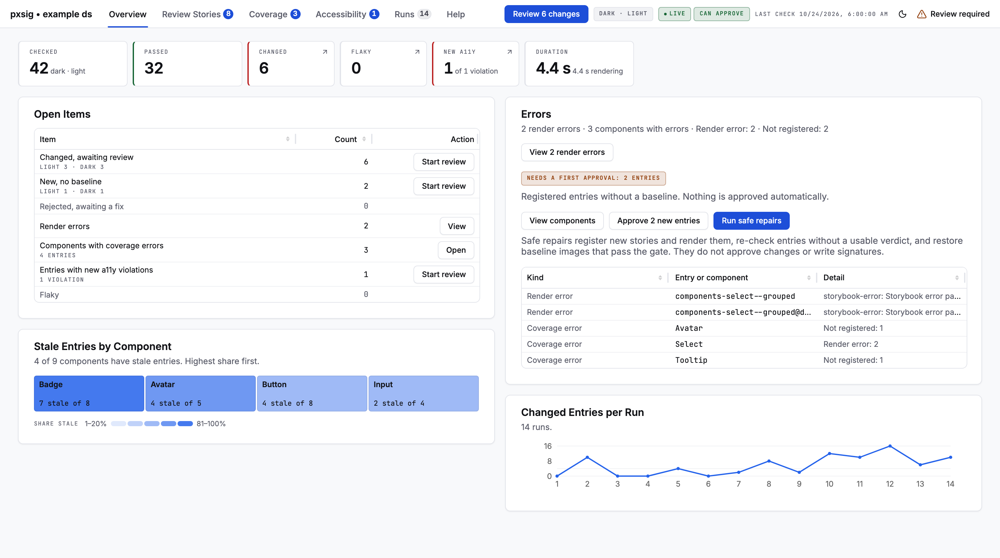
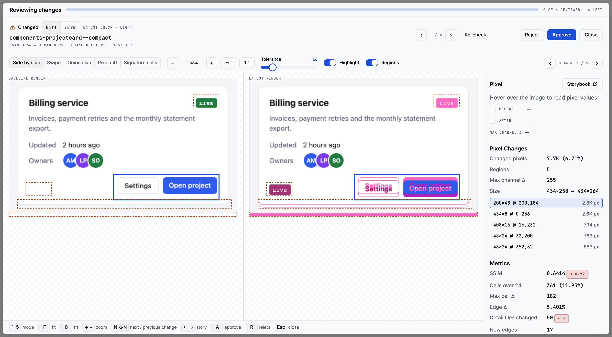

# pxsig

Visual regression for Storybook that runs on your own machine and in your own CI.

**New here:** [QUICKSTART.md](QUICKSTART.md) goes from install to a reviewed first baseline and CI,
including how approving from the dashboard works (the dashboard link and the top bar's badges).





pxsig renders every story state with Playwright, reduces each render to a compact pixel
signature, and compares it with an approved baseline. Each baseline is one `.psig` file per story
state: the signature and the full baseline image, packed together. The files live with the
project under test and are committed with it, so a visual change is reviewed like any other
change.

- **Engine.** The Rust crate `pxsig-core` builds signatures (spec v1), computes the metrics and
  applies the gate. The `pxsig` binary runs it in parallel over a whole manifest.
- **Dashboard.** `pxsig serve` opens a local dashboard: what changed, side by side, as a swipe,
  an onion skin, a pixel diff or a heat map of the signature cells, with approve and reject on
  each entry.
- **Storybook addon.** `@pxsig/storybook-addon` adds a panel and sidebar status dots.
- **MCP server.** `pxsig mcp` gives an agent the same status, images and re-checks. It cannot
  approve a baseline. `pxsig setup` prints the entry for each coding assistant
  ([docs/agents.md](docs/agents.md)).
- **Integrity doctor.** `pxsig doctor` reports what a passing check does not cover: stories with no
  entry, entries never checked, baselines without an image, stale verdicts, orphans. It never
  writes a signature and never approves.

## Why

- **Offline.** No account, no sign-in, no upload. Renders and baselines stay on your machines.
- **Reviewable.** Baselines are files in your repository. `git diff` shows who approved what (see
  [docs/monorepo.md](docs/monorepo.md#reviewing-psig-changes-in-git)).
- **No drift unless approved.** A baseline changes only when a person approves it. Every approval
  is logged with the hash of the file before and after, and can be undone.
- **Stable.** The gate compares coarse signatures, not raw pixels, so anti-aliasing and font
  hinting noise does not fail a build. A detail channel catches thin features (borders, icons)
  that a coarse grid would average away.

## Status

pxsig is on npm in two packages: [`pxsig`](https://www.npmjs.com/package/pxsig) (CLI, engine,
server, dashboard and MCP server) and
[`@pxsig/storybook-addon`](https://www.npmjs.com/package/@pxsig/storybook-addon); npm shows the
current version. Releases are published from GitHub Actions with npm provenance and listed in
[CHANGELOG.md](CHANGELOG.md).

## Requirements

- Node.js 22 or later (22.18 or later to work in a clone of this repository)
- A Storybook (8 or later; the addon needs 9 or later) that pxsig can reach over HTTP with its
  `index.json`, or a static build of one (`storybook.staticDir`), which pxsig serves itself when
  nothing answers at `storybook.url`
- Playwright, installed in your workspace (`pnpm add -D playwright`, then
  `npx playwright install chromium`)

## Quick start: one package

Run these in the package that has the stories. Storybook must be running for `manifest` and
`check`.

```bash
npm install -D pxsig playwright
npx playwright install chromium

npx pxsig init                    # writes pxsig.config.json and the .pxsig/ store
npx pxsig manifest                # lists every story x mode x state, from the running Storybook
npx pxsig check --full            # renders and checks them; the first run marks every entry NEW
npx pxsig serve                   # opens the dashboard: review and approve each first render
npx pxsig doctor                  # confirms nothing is uncovered
```

The first `check --full` exits 1, because no entry has a baseline yet. Approve the first renders in
the dashboard (press `A` in the inspector). In bulk, plan them with
`npx pxsig approve plan --new --first-baselines --reason "first baselines"` and apply the plan with
`npx pxsig approve apply` (a person at a terminal, with the server running). A person at a
terminal can also write every baseline at once with `npx pxsig check --full --update`, after
typing a confirmation phrase.

Commit `pxsig.config.json` and the store (`.pxsig/`). The store's own `.gitignore` keeps renders,
diffs and reports out of git.

## Quick start: monorepo

Install pxsig once at the repository root, list the packages under test in
`pxsig.workspace.json`, and give each package its own config and store.

Create `pxsig.workspace.json` at the root, saved as UTF-8:

```json
{ "version": 1, "projects": {} }
```

Then, from the root:

```bash
pnpm add -D -w pxsig playwright
npx pxsig init packages/ui --storybook-config '$workspace/apps/storybook/.storybook'
npx pxsig init packages/charts --storybook-config '$workspace/apps/storybook/.storybook'

npx pxsig projects                               # the registered projects
npx pxsig manifest --project ui
npx pxsig check --full --project ui
npx pxsig serve                                  # one server and dashboard for every project
npx pxsig doctor --project ui
```

Inside a project's folder, `--project` can be left out. Read commands (`status`, `list`, `doctor`,
…) with no project chosen cover every project. One process writes a store at a time: a full check
against a project the server is serving goes through the server's queue. See
[docs/monorepo.md](docs/monorepo.md).

## Running from a clone

To work on pxsig itself, or to try an unreleased change (Node.js 22.18 or later in a clone; the
published package needs 22):

```bash
git clone https://github.com/hydrotik/pxsig
cd pxsig
pnpm install
cargo build --release                            # builds target/release/pxsig
node packages/pxsig/bin/pxsig.mjs --help
```

From a source checkout, the CLI finds the binary in `target/release/`. To use a clone from another
repository, link the package (`pnpm add -D link:<path-to-clone>/packages/pxsig`) and set
`PXSIG_BIN` to the built binary. The dashboard ships prebuilt in the npm package; a clone does not
include it, and `pnpm build:dashboard` builds it on the plain adapter (see
[packages/dashboard/README.md](packages/dashboard/README.md)).

## Documentation

| Topic                                                                                  | File                                                                                             |
| -------------------------------------------------------------------------------------- | ------------------------------------------------------------------------------------------------ |
| Signature format, metrics, gate, `.psig` container, manifest                           | [docs/spec.md](docs/spec.md)                                                                     |
| Configuration files, layers, environment, story parameters                             | [docs/configuration.md](docs/configuration.md)                                                   |
| Workspaces, projects and stores                                                        | [docs/monorepo.md](docs/monorepo.md)                                                             |
| Every command and flag                                                                 | [docs/cli.md](docs/cli.md)                                                                       |
| Integrity codes, repairs and guarantees                                                | [docs/integrity.md](docs/integrity.md)                                                           |
| Server, HTTP API and dashboard                                                         | [docs/server.md](docs/server.md)                                                                 |
| The dashboard on your own design system: the UI contract and how to build an adapter   | [docs/ui/build-adapter.md](docs/ui/build-adapter.md), [docs/ui/features.md](docs/ui/features.md) |
| MCP server                                                                             | [docs/mcp.md](docs/mcp.md)                                                                       |
| Coding assistants: markers, the instruction not to approve, MCP recipes, `pxsig setup` | [docs/agents.md](docs/agents.md)                                                                 |
| How pxsig works across a team: what is shared, the workflow, deployed Storybooks       | [docs/team.md](docs/team.md)                                                                     |
| Storybook addon                                                                        | [docs/storybook.md](docs/storybook.md)                                                           |
| Continuous integration                                                                 | [docs/ci.md](docs/ci.md)                                                                         |
| The container image: the same renders on every machine                                 | [docs/container.md](docs/container.md)                                                           |
| Required checks, branch protection and the merge queue                                 | [docs/required-checks.md](docs/required-checks.md)                                               |
| Checks on a machine without hosted CI, as commit statuses                              | [docs/local-ci.md](docs/local-ci.md)                                                             |
| Baseline owners per component with CODEOWNERS                                          | [docs/codeowners.md](docs/codeowners.md)                                                         |
| Moving a pre-0.2 store                                                                 | [docs/migrating.md](docs/migrating.md)                                                           |
| Architecture                                                                           | [docs/architecture.md](docs/architecture.md)                                                     |
| Design decisions                                                                       | [docs/decisions.md](docs/decisions.md)                                                           |
| macOS, Linux and Windows: the programs pxsig starts, the browser, paths, line endings  | [docs/platforms.md](docs/platforms.md)                                                           |
| Errors pxsig prints, their causes and fixes                                            | [docs/troubleshooting.md](docs/troubleshooting.md)                                               |
| Releases: platform binaries, npm packages, the dashboard build                         | [docs/releasing.md](docs/releasing.md)                                                           |
| Research tools: scenarios, calibration, benchmarks                                     | [tools/README.md](tools/README.md)                                                               |

## Repository layout

| Path                                 | What it is                                                                                                                                                                                                |
| ------------------------------------ | --------------------------------------------------------------------------------------------------------------------------------------------------------------------------------------------------------- |
| `crates/pxsig-core`                  | The engine: signatures, metrics, detail channel, pixel diff, trimming, the `.psig` container                                                                                                              |
| `crates/pxsig-cli`                   | The `pxsig` binary: capture, compare, batch check and baseline, affected, report, pack, cat, attach, and a stdio engine for the server                                                                    |
| `packages/pxsig`                     | The npm package `pxsig`: CLI, workspace resolver, renderer, full check, server, MCP server, integrity, approvals, JSON schemas                                                                            |
| `packages/storybook-addon`           | `@pxsig/storybook-addon`: Storybook panel and sidebar statuses                                                                                                                                            |
| `packages/dashboard`                 | Dashboard source (React) on a UI contract (`src/ui/`), its diff-viewer primitives and the reference adapter; built into the `pxsig` package at release, and shipped as source for `pxsig dashboard build` |
| `docs`                               | The documentation above                                                                                                                                                                                   |
| `tools`                              | Research tools (not in the npm package): simulated regressions, gate and detail calibration, benchmarks; their reports feed the dashboard's Scenarios, Calibration and Performance tabs                   |
| `examples`                           | A single-package and a monorepo example, and a plain UI adapter (`custom-ui`), run end to end by `scripts/examples-test.mjs`                                                                              |
| `scripts/check-clean.mjs`            | Fails the build if images, baselines, run output or private paths are committed                                                                                                                           |
| `scripts/make-platform-packages.mjs` | Builds the `@pxsig/cli-<platform>-<arch>` packages at release time                                                                                                                                        |
| `.github/workflows`                  | CI (`ci.yml`) and the tag-driven release (`release.yml`)                                                                                                                                                  |

This repository holds source, schemas, tests and documentation only. Baselines, renders and
reports belong to the projects under test.

## Contributing and security

See [CONTRIBUTING.md](CONTRIBUTING.md), [SECURITY.md](SECURITY.md) and
[CODE_OF_CONDUCT.md](CODE_OF_CONDUCT.md).

## Licence

MIT. Copyright (c) 2026 Hydrotik LLC. See [LICENSE](LICENSE).
