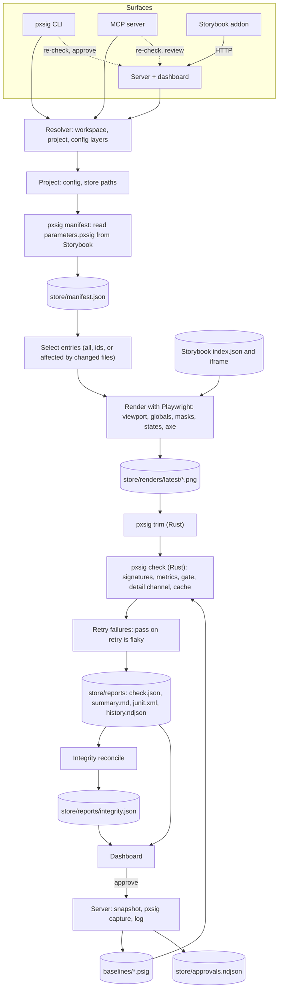

# Architecture

## Components

| Component | Where | Role |
| --- | --- | --- |
| Resolver | `packages/pxsig/src/lib/workspace.mjs` | Finds the workspace, picks the project, layers the config, computes the store's paths, finds the engine binary and the server. Every surface goes through it. |
| CLI | `packages/pxsig/src/cli.mjs` | The `pxsig` command. Reuses the MCP tools in-process and renders their answers for a terminal, Markdown or JSON. |
| Full check | `packages/pxsig/src/check.mjs` | Select, render, trim, check, retry, a11y, report, integrity. |
| Renderer | `packages/pxsig/src/lib/capture.mjs` | Deterministic Storybook renders with Playwright: a pool of pages, masks, interaction states, an axe pass. |
| Manifest | `packages/pxsig/src/lib/manifest.mjs`, `setup.mjs` | Reads `parameters.pxsig` from the running Storybook and expands stories into entries. Also `init` and `migrate`. |
| Server | `packages/pxsig/src/serve.mjs` | Dashboard, HTTP API, event stream, review, on-demand checks, watch mode, integrity for every project. |
| MCP server | `packages/pxsig/src/mcp.mjs` | The tools, over stdio. |
| Integrity | `packages/pxsig/src/lib/integrity.mjs`, `repair.mjs` | The ledger, and the safe repairs. |
| Approvals | `packages/pxsig/src/lib/approvals.mjs`, `approve.mjs` | Snapshot, log, undo, verify; the guarded bulk approval. |
| Engine | `crates/pxsig-core` | Signatures, metrics, gate, detail channel, pixel diff, trim, the `.psig` container. Pure: no filesystem access, no clock. |
| Engine binary | `crates/pxsig-cli` | Batch commands over a manifest on a thread pool, the import graph, reports, and a long-lived stdio mode for the server. |
| Dashboard | `packages/dashboard` | The React app the server and `pxsig report` serve. |
| Storybook addon | `packages/storybook-addon` | Panel and sidebar statuses, fed by the server. |

## Data flow

## A full check, step by step

1. **Resolve.** The resolver finds the workspace and project and writes a run manifest to
   `<store>/reports/.run/`: the committed entries plus the resolved settings (grid, gate, trim,
   modes, the paths that affect every entry). The engine reads only that file, so discovery and
   precedence exist once, in JS.
2. **Select.** All entries, or those named, or those the changed files affect. `pxsig affected`
   classifies each changed path ([ci.md](ci.md#how-selection-decides)): baselines and store
   records select their entries, the reverse import graph of `srcRoot` is walked from changed
   modules, and a path it cannot trace selects every entry.
3. **Guard.** Fetch Storybook's `index.json`. Unreachable or broken: stop with exit 2, render and
   record nothing.
4. **Render.** Playwright renders each entry in its mode's browser, viewport and color scheme, with
   the mode's globals in the iframe URL. Animations frozen, `Math.random` fixed, fonts awaited,
   layout stability awaited. Masks, interaction states and the axe pass run here. Renders that hit
   Storybook's error page are flagged; when most do, the run stops as a setup error.
5. **Trim.** The engine crops renders to their content, right and bottom only.
6. **Check.** The engine compares each render with its baseline in parallel, with the gate resolved
   per entry, and writes diff images for failures. A content cache skips unchanged pairs.
7. **Retry.** Failures re-render up to `--retries` times; a pass on retry marks the entry flaky.
8. **Report.** `check.json`, `summary.md` and `junit.xml`; one line in `history.ndjson`.
9. **Integrity.** The ledger is recomputed and written.

## The server

The server keeps, per workspace:

- one engine process (`pxsig serve`), spoken to over stdin and stdout, one JSON request per line;
- one pool of browsers, shared by every project;
- per project: the run manifest, a queue of entries to re-check, the integrity ledger, and file
  watchers on the sources, baselines, renders, manifest and reports.

It holds each served project's store lock, so it is that store's only writer while it runs.
Re-checks from the dashboard, the addon, the MCP server, the CLI (a full check against a served
project included) and watch mode all go through the project's queue and merge their rows into
`check.json`. Approvals go through one function that
snapshots the old baseline, writes the new `.psig` with the engine, and logs the change, whoever
asked.

## Boundaries

- **The engine never discovers anything.** It takes explicit paths (`--manifest`, `--png-dir`,
  `--root`) and numbers.
- **Integrity never writes a signature.** Its writes go through a guard that refuses baseline
  files; the writes to baselines it can trigger are the engine's `attach` and `pack`, which prove
  the signature is unchanged.
- **One writer per store.** `<store>/reports/.lock` names the process that may write the store
  (see [monorepo.md](monorepo.md#store-layout)).
- **Nothing a run produces lands in the tool's folder.** Every output path comes from the project's
  store.
