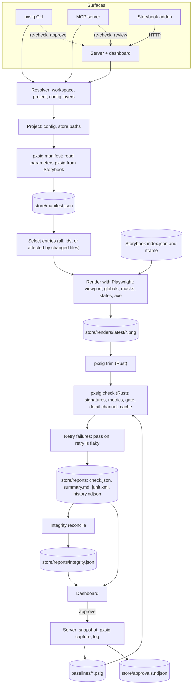

# Architecture

## Components

| Component             | Where                                                                                     | Role                                                                                                                                                                                                                                                                                                                                                                   |
| --------------------- | ----------------------------------------------------------------------------------------- | ---------------------------------------------------------------------------------------------------------------------------------------------------------------------------------------------------------------------------------------------------------------------------------------------------------------------------------------------------------------------- |
| Resolver              | `packages/pxsig/src/lib/workspace.mjs`, `lib/workspace/`                                  | Finds the workspace, picks the project, layers the config, computes the store's paths, finds the engine binary and the server. Every surface goes through it. `lib/workspace/`: finding the workspace (`find`), config layers (`layers`), the project and its store (`project`), the run manifest, peers and the engine binary (`peers`), version checks (`versions`). |
| CLI                   | `packages/pxsig/src/cli.mjs`, `cli/`                                                      | The `pxsig` command. Runs the tools (`src/tools/`) in-process and renders their answers for a terminal, Markdown or JSON. cli.mjs parses and dispatches; `cli/` holds the commands, by group.                                                                                                                                                                          |
| Full check            | `packages/pxsig/src/check.mjs`                                                            | Select, render, trim, check, retry, a11y, report, integrity.                                                                                                                                                                                                                                                                                                           |
| Renderer              | `packages/pxsig/src/lib/capture.mjs`, `lib/capture/`                                      | Deterministic Storybook renders with Playwright: a pool of pages, masks, interaction states, an axe pass. `lib/capture/`: the browser launch and its fallbacks (`browser`), one page (`page`), the render queue (`render`).                                                                                                                                            |
| Manifest              | `packages/pxsig/src/lib/manifest.mjs`, `lib/setup.mjs`, `lib/setup/`                      | Reads `parameters.pxsig` from the running Storybook and expands stories into entries. `lib/setup.mjs` is `init`, `manifest` and `migrate`; `lib/setup/` holds the migration and what they share. (`src/setup.mjs` is `pxsig setup`, the assistant step: see Assistants.)                                                                                               |
| Server                | `packages/pxsig/src/serve.mjs`                                                            | Dashboard, HTTP API, event stream, review, on-demand checks, watch mode, integrity for every project.                                                                                                                                                                                                                                                                  |
| Tools                 | `packages/pxsig/src/tools/`                                                               | What the MCP server serves and the CLI runs in-process: the project context, staleness, the doctor, and the tool groups (read, inspect, act, info).                                                                                                                                                                                                                    |
| MCP server            | `packages/pxsig/src/mcp.mjs`                                                              | The tools (`src/tools/`), over stdio.                                                                                                                                                                                                                                                                                                                                  |
| Integrity             | `packages/pxsig/src/lib/integrity.mjs`, `lib/integrity/`, `lib/repair.mjs`, `lib/repair/` | The ledger, and the safe repairs. `lib/integrity/`: status codes, the context, the setup problems, the reconcile, the story index. `lib/repair/`: the plan, applying it, restoring images, registering new stories.                                                                                                                                                    |
| Approvals             | `packages/pxsig/src/lib/approvals.mjs`, `lib/approvals/`, `src/approve.mjs`               | History copy, log, undo, verify; the guarded bulk approval. `lib/approvals/`: the log and its lines (`core`), the PR summary and `--trace` (`history`), `undo`.                                                                                                                                                                                                        |
| Server guard          | `packages/pxsig/src/lib/guard.mjs`                                                        | Who may write through `pxsig serve`: the dashboard link and its cookie, the CLI's and the MCP server's file tokens, the Origin, `Sec-Fetch-Site` and Host checks. A guard, not authentication ([server.md](server.md#guards)).                                                                                                                                         |
| Programs started      | `packages/pxsig/src/lib/spawn.mjs`                                                        | The only place pxsig starts a program: a per-OS allow-list, never a shell ([platforms.md](platforms.md#programs-pxsig-starts)). A test fails on any other process start.                                                                                                                                                                                               |
| Browser and clipboard | `packages/pxsig/src/lib/open.mjs`, `lib/clipboard.mjs`                                    | Open a dashboard address in the default browser (`serve`, `serve --link --open`) and put the dashboard link on the clipboard (`serve --link --copy`, opt-in). Both start their program through `lib/spawn.mjs`; on Windows neither starts anything and the link is printed.                                                                                            |
| Store lock            | `packages/pxsig/src/lib/lock.mjs`                                                         | One writer per store: `<store>/reports/.lock`, taken by every command that writes baselines, the manifest or the report, and by the server for each project it serves.                                                                                                                                                                                                 |
| Machine folder        | `packages/pxsig/src/lib/machine.mjs`                                                      | What pxsig keeps outside every repository: `settings.json`, the Windows token files, and each clone's state folder ([platforms.md](platforms.md#what-pxsig-keeps-on-this-machine)).                                                                                                                                                                                    |
| Assistants            | `packages/pxsig/src/lib/agents.mjs`, `lib/assistants.mjs`, `src/setup.mjs`                | Which coding assistant started the process, from its environment marker; each assistant's MCP recipe and instruction; `pxsig setup` ([agents.md](agents.md)).                                                                                                                                                                                                          |
| Store snapshot        | `packages/pxsig/src/snapshot.mjs`                                                         | `pxsig snapshot`: the committed store and git as one read-only JSON file, for a deployed Storybook ([team.md](team.md)).                                                                                                                                                                                                                                               |
| Render environment    | `packages/pxsig/src/lib/env.mjs`, `lib/env/`                                              | Which browser, OS, fonts and settings produced a render: kept in each new baseline's header and compared on every check (`env-mismatch`, `--strict-env`). Names no machine or person. `lib/env/`: collecting the facts (`collect`), the environment id (`id`).                                                                                                         |
| Warn mode             | `packages/pxsig/src/lib/enforcement.mjs`, `lib/enforcement/`                              | Per gate, `enforce` or `warn`: the same checks on the same selection; only the exit code changes, and every surface says so. `lib/enforcement/`: resolving the gates (`resolve`), findings, the lead and last lines (`lines`), the readiness tally.                                                                                                                    |
| SARIF                 | `packages/pxsig/src/lib/sarif.mjs`                                                        | New accessibility violations as SARIF 2.1.0 (`--sarif`). Output only.                                                                                                                                                                                                                                                                                                  |
| Browser container     | `packages/pxsig/src/browser.mjs`                                                          | `pxsig browser start\|stop\|status`: Playwright's browser server in the pxsig image, which checks and the server connect to ([container.md](container.md)). The only commands that start `docker`.                                                                                                                                                                     |
| Dashboard check       | `packages/pxsig/src/dashboard-check.mjs`                                                  | `pxsig dashboard check`: every dashboard screen on a project's adapter build, from sample data, beside the reference build.                                                                                                                                                                                                                                            |
| Types                 | `packages/pxsig/src/types.d.ts`, `src/types/*.d.ts`                                       | The shapes the JavaScript passes around, for its JSDoc and `tsc --checkJs`. Nothing in them runs.                                                                                                                                                                                                                                                                      |
| Engine                | `crates/pxsig-core`                                                                       | Signatures, metrics, gate, detail channel, pixel diff, trim, the `.psig` container. Pure: no filesystem access, no clock.                                                                                                                                                                                                                                              |
| Engine binary         | `crates/pxsig-cli`                                                                        | Batch commands over a manifest on a thread pool, the import graph, reports, and a long-lived stdio mode for the server.                                                                                                                                                                                                                                                |
| Dashboard             | `packages/dashboard`                                                                      | The React app the server and `pxsig report` serve.                                                                                                                                                                                                                                                                                                                     |
| Storybook addon       | `packages/storybook-addon`                                                                | Panel and sidebar statuses, fed by the server; on a deployed Storybook, the read-only snapshot its build carries (`snapshot-view.mjs`, which makes no request to a server). `server-pick.mjs` decides whether the panel may use the server that answered: only one that serves this Storybook's workspace (`workspaceId`).                                             |

## Data flow

## A full check, step by step

1. **Resolve.** The resolver finds the workspace and project and writes a run manifest to
   `<store>/reports/.run/`: the committed entries plus the resolved settings (grid, gate, trim,
   modes, the paths that affect every entry). The engine reads only that file, so discovery and
   precedence exist once, in JS.
2. **Select.** All entries, or those named, or those the changed files affect. `pxsig affected`
   classifies each changed path ([ci.md](ci.md#how-selection-decides)): baselines and store
   records select their entries, the reverse import graph (`srcRoot`, the "affects every entry"
   folders and the workspace packages imports reach; every file type,
   [ci.md](ci.md#what-counts-as-an-import)) is walked from changed files, and a path it cannot
   trace selects every entry. The resolver is `crates/pxsig-cli/src/resolve.rs`.
3. **Guard.** Fetch Storybook's `index.json`. Unreachable or broken: stop with exit 2, render and
   record nothing.
4. **Render.** Playwright renders each entry in its mode's browser, viewport and color scheme, with
   the mode's globals in the iframe URL. Animations frozen, `Math.random` fixed, fonts awaited,
   layout stability awaited. Masks, interaction states and the axe pass run here. Renders that hit
   Storybook's error page are flagged; when most do, the run stops as a setup error.
5. **Trim.** The engine crops renders to their content, right and bottom only.
6. **Check.** The engine compares each render with its baseline in parallel, with the gate resolved
   per entry, and writes diff images for failures. A content cache skips unchanged pairs.
7. **Retry.** Failures re-render up to `--retries` times; a pass on retry marks the entry flaky.
8. **Report.** `check.json`, `summary.md` and `junit.xml`; one line in `history.ndjson`.
9. **Integrity.** The ledger is recomputed and written.

## The server

The server keeps, per workspace:

- one engine process (`pxsig serve`), spoken to over stdin and stdout, one JSON request per line;
- one pool of browsers, shared by every project;
- per project: the run manifest, a queue of entries to re-check, the integrity ledger, and file
  watchers on the sources, baselines, renders, manifest and reports.

It holds each served project's store lock, so it is that store's only writer while it runs.
Re-checks from the dashboard, the addon, the MCP server, the CLI (a full check against a served
project included) and watch mode all go through the project's queue and merge their rows into
`check.json`. Approvals go through one function that
snapshots the old baseline, writes the new `.psig` with the engine, and logs the change, whoever
asked.

## pxsig's own baselines

pxsig checks its own dashboard the way it checks a design system. `packages/dashboard` renders
every screen of every feature from sample data (`fixtures/scenarios.mjs`, `fixtures/screens.json`)
on the reference design system's build, and `packages/dashboard/.pxsig/` holds their approved
baselines. `scripts/screens-container.mjs` runs the check in the pinned image
(`docker/screens-image.json`). Beside the pixels it compares each screen's accessibility tree
and its anchored controls' boxes with the locked copies in `packages/dashboard/fixtures/locked/`
(`scripts/lib/screen-locks.mjs`), and fails on any axe or layout finding. The `screens` workflow
runs it on every pull request and `main`, and the release runs it before publishing
([releasing.md](releasing.md#pxsigs-own-baselines)).

## Boundaries

- **The engine never discovers anything.** It takes explicit paths (`--manifest`, `--png-dir`,
  `--root`) and numbers.
- **Integrity never writes a signature.** Its writes go through a guard that refuses baseline
  files; the writes to baselines it can trigger are the engine's `attach` and `pack`, which prove
  the signature is unchanged.
- **One writer per store.** `<store>/reports/.lock` names the process that may write the store
  (see [monorepo.md](monorepo.md#store-layout)).
- **Nothing a run produces lands in the tool's folder.** Every output path comes from the project's
  store.
